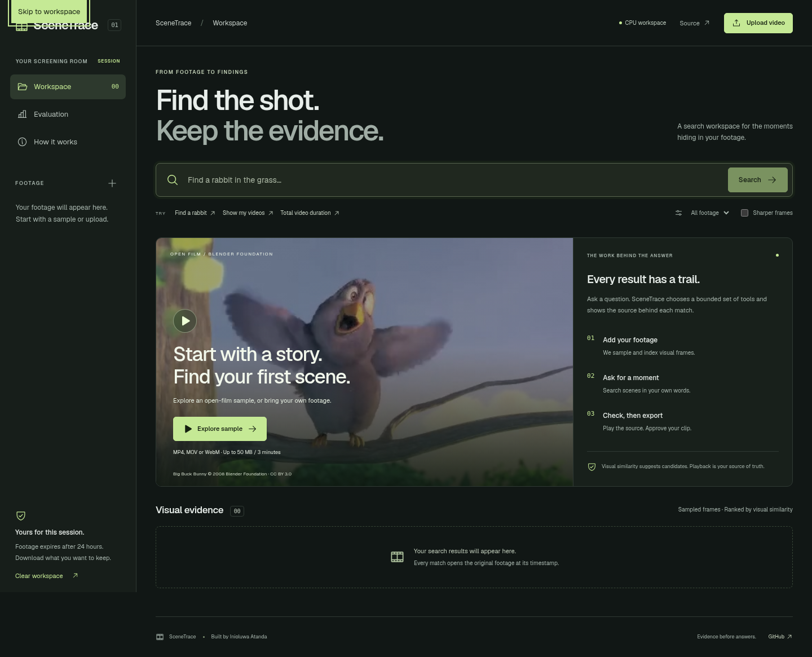

# SceneTrace

An evidence-first video workspace for editors and small content teams. Upload footage, search
its visual contents, inspect the matching frames, and approve a time-bounded clip export.
Search results link to the actual source video; similarity scores are not probabilities or
proof that an event happened.

[Open the workspace](https://scenetrace-inioluwa.vercel.app) ·
[Hugging Face launcher](https://huggingface.co/spaces/Ineeoluwa/scenetrace) ·
[Router weights](https://huggingface.co/Ineeoluwa/scenetrace-router-135m) ·
[Training traces](https://huggingface.co/datasets/Ineeoluwa/scenetrace-tool-traces)



The product combines an open-weight visual retriever with a separately post-trained language
model that selects bounded tool plans. It is designed to be useful on CPU hardware.

## Build record

This repository was implemented in October 2026. At the owner's request, Git author and
committer timestamps are assigned retrospectively across January–March 2026. Those timestamps
are an organizational presentation of the implementation stages, not evidence that the work,
deployments, training runs, or user adoption occurred in those months. Training and evaluation
artifacts retain their actual execution times. No user or customer counts are asserted.

## Product scope

- Private visitor workspace, streamed uploads, bounded background indexing, and deletion.
- Real image/text embedding search with timestamped, playable visual evidence.
- Multi-turn query context, typed tools, call budgets, recoverable errors, and export approval.
- An actual SFT → group-relative policy optimization experiment on a small open-weight model.
- Replay evaluation with frozen splits, executable rewards, latency and compute-cost accounting.
- Object detection and a bounding-box-assisted image mask for inspecting a selected frame.

The public CPU deployment is a session workspace, not an archival video hosting service.
Uploads expire after 24 hours. Download exports you want
to keep. A persistent mounted data directory is supported for self-hosting.

## Development

Python 3.12, Node 24, FFmpeg and FFprobe are required. The complete setup, test, model training,
deployment instructions and measured limitations are included below. No paid API key is needed.

```bash
uv sync --frozen --extra dev
npm ci --prefix web --ignore-scripts
npm run build
uv run python scripts/download_models.py
uv run python scripts/release_gate.py
uv run uvicorn scenetrace.app:app --host 127.0.0.1 --port 4350 --no-access-log
```

Open `http://127.0.0.1:4350`. First model downloads are approximately a gigabyte. CPU Torch
uses the separate official CPU wheel index; CUDA is not required. The released LoRA adapter
is checked in. Original model weights are downloaded at their pinned publisher revisions.

For frontend development, run the API on port 4350 and `npm run dev --prefix web`; set
`SCENETRACE_PUBLIC_ORIGIN=http://127.0.0.1:4351` on the API when using Vite's proxy.

## Using the workspace

1. Choose **Explore sample** or upload an MP4, MOV or WebM up to 50 MiB / three minutes.
2. Wait for the indexing job to become ready. Model downloads and CPU work can make the
   initial request slower; indexing continues independently of the current browser request.
3. Ask **Find footage showing a rabbit**, **Show my videos**, or **Total video duration**.
4. Open a result to play its source timestamp. Compare the frame with the source before
   treating the match as a finding. The sharper-frames option filters Laplacian sharpness.
5. Select a start/end range, prepare the export, then approve it. Download the rendered MP4.
   Exports use the retained source, resized to at most 720p and capped at 24 fps; the player
   uses a smaller preview proxy. Your original upload is retained until deletion/expiry.
6. Optionally run DETR on a selected frame, inspect predicted boxes, and create a GrabCut
   foreground mask for a detected box. This is not semantic segmentation or a depth model.

## Reproduce the training

```bash
uv run python training/data.py
uv run python training/train.py
uv run python scripts/prepare_release.py
uv run python scripts/release_gate.py
uv run python scripts/evaluate_retrieval.py
```

The trainer performs actual completion-only LoRA SFT, then finite-action GRPO with verifiable
route labels. It selects SFT or GRPO on validation data before evaluating the held-out test.
All 560 requests are synthetic; template families are split as 480/40/40. This is a routing
experiment, not post-training a VLM or proving general reasoning gains. The served adapter
and report include hashes and real execution times. See [the full protocol](docs/training.md),
[raw evaluation](artifacts/evaluation.json), and [retrieval checks](artifacts/retrieval-evaluation.json).

The sample-film retrieval check includes six illustrative queries with contact-sheet
annotations supplied during implementation, without independent human review. It records
failures, rather than using those examples to claim broad video understanding.

## Verification

```bash
uv run ruff check backend training tests scripts
uv run pytest -q
npm run build
npm audit --prefix web --audit-level high
cd web
npx playwright install --with-deps chromium
DEMO_URL=http://127.0.0.1:4350 npm test
```

Backend tests use explicit model doubles to isolate authorization, media processing, job
recovery and approval behavior. Browser integration uses the actual released model and
CLIP on real video, then checks a downloaded export with FFprobe. Desktop/mobile checks
include automated accessibility checks, keyboard access and horizontal overflow. These
checks do not imply an independent accessibility or security audit. The CI workflow reruns
the release gate and the real browser workflow.

## Deployment and privacy

The Docker image serves the complete application on port 7860. The live release runs on the existing CPU server behind Nginx and TLS. `vercel.json` redirects its entry URL to that same-origin workspace. The Hugging Face Space is a static launcher for the live application. Docker hosting on Hugging Face requires PRO; no subscription was added. Public uploads are
session-scoped, not placed in a public dataset or used automatically for training.

For persistent self-hosting, mount a writable directory as `SCENETRACE_DATA` and set a stable
private `SCENETRACE_SESSION_SECRET`. Run one Uvicorn worker per data directory. Public hosting
uses a private working directory, a shared six-job queue and CPU inference. It
has no availability SLA. Authentication with durable accounts, distributed jobs, external
object storage and independently calibrated real-user evaluation are future scale-up work,
not capabilities claimed by this release. See [architecture and operational boundaries](docs/architecture.md).

The OpenAPI schema is at `/openapi.json` on the backend. Typed tool schemas
are available at `/api/tools`; a protected explicit retrieval endpoint is at `/api/search`.
The agent never executes model-generated code or arbitrary SQL. Export rendering always
requires the visitor's explicit approval, independent of the selected tool plan.

## Media attribution

The included demonstration is an excerpt of **Big Buck Bunny** (2008),
(c) copyright 2008, Blender Foundation / [www.bigbuckbunny.org](https://www.bigbuckbunny.org/),
licensed under [CC BY 3.0](https://creativecommons.org/licenses/by/3.0/).
Changes: excerpted, resized and re-encoded for the workspace. The filmmakers do not endorse
SceneTrace. [Original license information](https://peach.blender.org/about/).
